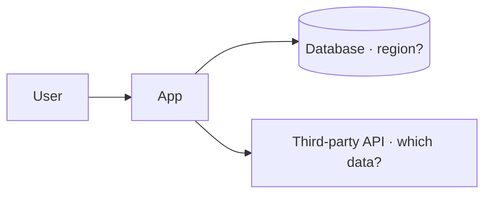

# Architecture

The Markdown files in this folder are the **source of truth** for the architecture; the
compliance evaluator reads them. Slides in [`slides/`](slides/) are presentation material.
If they disagree, the Markdown wins: fix the slides.

## Conventions

- One file per view: `overview.md` (context and main components), `data-flows.md`
  (what data goes where), `deployment.md` (hosting, regions, providers).
- Draw diagrams as code with [Mermaid](https://mermaid.js.org) inside the Markdown, not as
  pasted images: they are diffable and the evaluator can read them.
- In `data-flows.md`, name every store and every third party that receives data, and say
  which categories of data (from `compliance.yml`) travel in each flow.
- Record architecture decisions in the Decisions table of
  [`docs/PROJECT_CONTEXT.md`](../PROJECT_CONTEXT.md).

