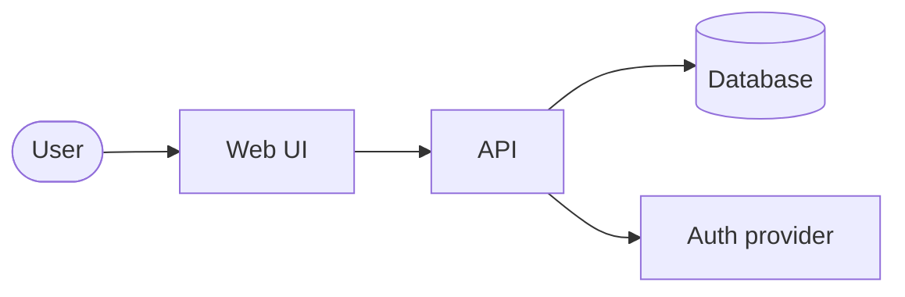

# Architecture overview

> Filled during bootstrap (Phase 2) and kept up to date. Significant changes require an ADR in `docs/architecture/decisions/` (template: `docs/resources/templates/adr-template.md`).

## Context

TODO: one paragraph — what the system does, who uses it, which external systems it talks to.

## Components

| Component | Responsibility | Technology | Hosted on |
|---|---|---|---|
| TODO | | | |

## Diagram

## Data flow

TODO: main flows (e.g. sign-up, core feature) step by step.

## Cross-cutting concerns

| Concern | Approach (see PROJECT_CONTEXT for the decision) |
|---|---|
| Data hosting & residency | TODO |
| Scalability | TODO |
| Security | TODO |
| Access control | TODO |
| Cost control | TODO |
| Observability | TODO |

## Decision log

| ADR | Title | Status |
|---|---|---|
| — | _No decisions recorded yet_ | — |
