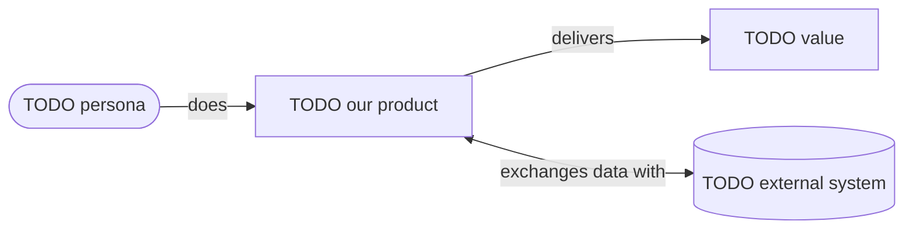

# Business overview

!!! info "For whom"
    Anyone who needs to understand **why** this project exists and **what** it will do, with no technical knowledge required. Written in plain language; technical details live in [Architecture](../architecture/overview.md).

## The problem

TODO: describe the situation today and why it hurts (who suffers, how often, what it costs). 3–6 sentences.

## Our solution

TODO: what the product does to solve it, in plain words. Avoid jargon such as "API", "microservice" or "database"; describe what users can **do**.

## Who it is for

| Persona | Who they are | What they need from us |
|---|---|---|
| TODO | | |

## Value and success

| Goal | How we will measure it | Target |
|---|---|---|
| TODO (e.g. reduce time to process a request) | TODO (e.g. average minutes per request) | TODO |

## Scope

=== "In scope (first version)"

    - TODO

=== "Not in scope (for now)"

    - TODO

## The big picture

## Key constraints in plain language

| Topic | What it means for the business |
|---|---|
| Where data lives | TODO (e.g. "All customer data stays in EU data centres.") |
| Growth | TODO (e.g. "Designed for up to 1,000 users in year one; can grow beyond.") |
| Security | TODO (e.g. "Login with email verification; admins need a second factor.") |
| Costs | TODO (e.g. "Running costs under 50 USD/month during the MVP, with alerts.") |
| Who can access what | See [Roles & permissions](roles-and-permissions.md) |

## Risks and open questions

| Risk / question | Impact | Mitigation / next step |
|---|---|---|
| TODO | | |
