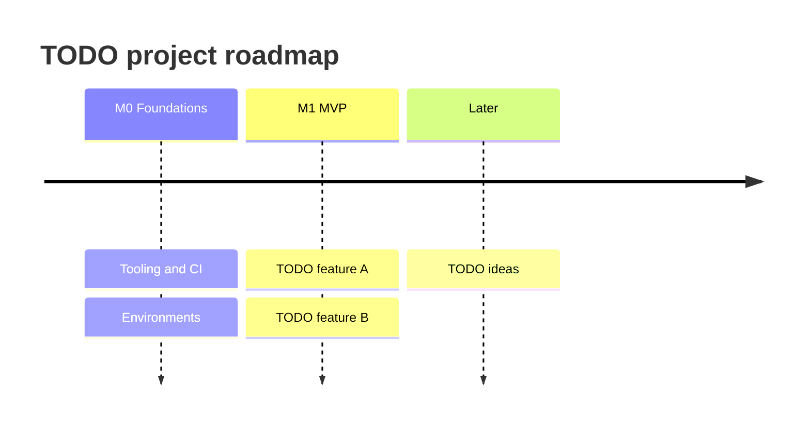

# Roadmap

!!! info "For whom"
    Stakeholders who want to know **what comes when**. The detailed, always up-to-date list of work is in the [Backlog](../backlog/index.md); this page tells the story behind it.

## Milestones

| Milestone | What users get | Target date | Status |
|---|---|---|---|
| M0 Foundations | Nothing visible yet: the technical base (quality checks, environments, security basics) | TODO | TODO |
| M1 MVP | TODO | TODO | TODO |

## Timeline

## What we deliberately postponed

| Idea | Why later | Revisit when |
|---|---|---|
| TODO | | |

## Change log of the roadmap

| Date | Change | Reason |
|---|---|---|
| TODO | Initial roadmap | Bootstrap |
