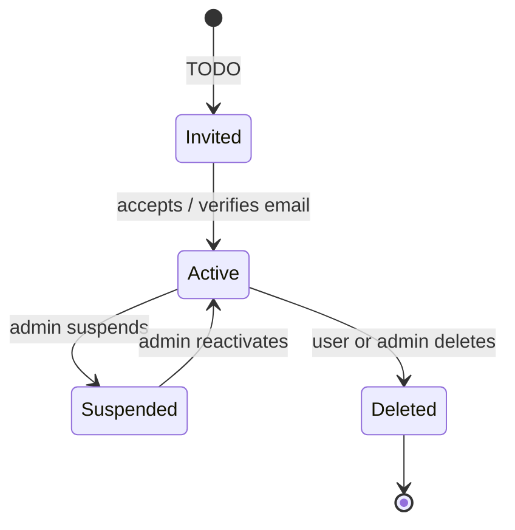

# Roles & permissions

!!! info "For whom"
    Business owners deciding **who may do what**, and developers implementing it. This is the business view of the permission matrix in [Project context](../project-context/PROJECT_CONTEXT.md#6-access-control-identity). Keep both in sync.

## Roles

| Role | Who has it | How they get it |
|---|---|---|
| TODO (e.g. Admin) | TODO | TODO (e.g. assigned by another admin) |
| TODO (e.g. Member) | TODO | TODO (e.g. self sign-up) |

## What each role can do

| Capability | TODO role A | TODO role B | Notes |
|---|:---:|:---:|---|
| TODO (e.g. View own data) | ✅ | ✅ | |
| TODO (e.g. Manage users) | ✅ | ❌ | |

## Signing in

TODO: how people sign in (email, Google, company SSO…), whether a second factor is needed, and what happens if they forget their password, in plain words.

## Lifecycle of an account

