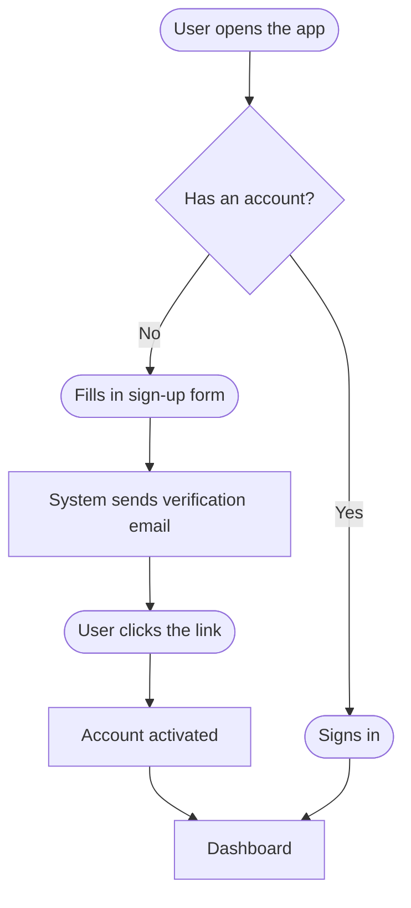
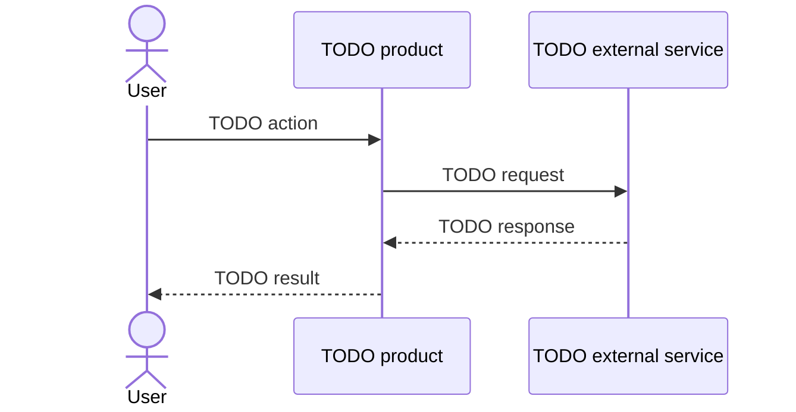

# User journeys

!!! info "For whom"
    Business and product people who want to see **how people will use the product**, step by step. Each journey is a flowchart that can be read without technical knowledge. Developers use the same journeys to derive end-to-end tests.

**How to read the diagrams:** rounded boxes are what the user does, diamonds are decisions, and rectangles are what the system does.

---

## Journey 1 — TODO name (e.g. "Signing up")

**Who:** TODO persona · **Goal:** TODO · **Related backlog items:** TODO (e.g. US-001)

| Step | What happens | What can go wrong | What the user sees then |
|---|---|---|---|
| 1 | TODO | TODO | TODO |

---

## Journey 2 — TODO

**Who:** TODO · **Goal:** TODO · **Related backlog items:** TODO

