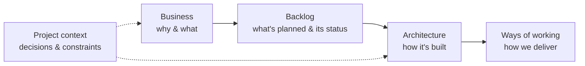

# {{PROJECT_NAME}}

!!! abstract "In one sentence"
    TODO: what this project does and for whom, in plain language.

This site is the project's **single place for knowledge**. Business, product and technical people, and the AI agents that help build the project, all read the same pages. Everything here lives in the repository, next to the code and the backlog, so it is versioned and reviewed like code.

## Where to start

| I am… | Start here |
|---|---|
| **Business / product / stakeholder** | [Business overview](business/overview.md) → [User journeys](business/user-journeys.md) → [Roadmap](business/roadmap.md) |
| **Following progress** | [Backlog](backlog/index.md): every epic, story and task, with status and dependencies |
| **Developer** | [Architecture](architecture/overview.md) → [Project context](project-context/PROJECT_CONTEXT.md) → [Ways of working](process/definition-of-ready.md) |
| **AI agent** | `AGENTS.md` at the repository root, then [Project context](project-context/PROJECT_CONTEXT.md) |

## Project at a glance

| | |
|---|---|
| **Problem we solve** | TODO |
| **Who uses it** | TODO |
| **Current milestone** | TODO |
| **Status** | TODO (e.g. "Building the MVP") |
| **Owner / contact** | TODO |

## How this documentation is organised

## Viewing these docs

- **Online:** open the documentation URL (GitHub Pages or Cloudflare Pages). Nothing to install.
- **Offline:** open `docs-site/index.html` from the repository (double-click). Nothing to install, no internet needed.
- **On GitHub:** browse the `docs/` folder; Markdown and diagrams render directly.
