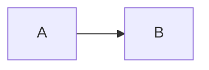

# Writing documentation

The `docs/` folder is the project's wiki. It is turned into a website (`docs-site/index.html`) for people **and** read directly by AI agents as context, so it must work for both.

## Principles

1. **Docs live with the code.** A change that alters behaviour, scope, roles, costs or architecture updates the docs **in the same pull request**.
2. **Two audiences, separate places.** `docs/business/` is plain language for non-technical readers. `docs/architecture/`, `docs/process/` and `docs/project-context/` can be technical.
3. **Diagrams are text.** Use Mermaid (` ```mermaid ` blocks) so diagrams are versioned, reviewable and readable by AI agents. No exported images of diagrams.
4. **One source of truth per fact.** Link instead of copying. Decisions belong in PROJECT_CONTEXT or an ADR, the backlog in `docs/backlog/backlog.json`, and status in `.harness/state/feature_list.json`.
5. **Write for scanning.** Use short sections and tables, and put a "For whom" note at the top of business pages.
6. **No secrets or personal data**, ever. The site may be published online.

## Where things go

| Content | File |
|---|---|
| Why the project exists, value, scope | `business/overview.md` |
| How people use the product (flowcharts) | `business/user-journeys.md` |
| Who may do what | `business/roles-and-permissions.md` (+ matrix in PROJECT_CONTEXT) |
| What comes when | `business/roadmap.md` |
| Shared vocabulary | `business/glossary.md` |
| Backlog definition (epics/stories/tasks) | `backlog/backlog.json`, which generates `backlog/index.md` |
| Cross-cutting decisions & constraints | `project-context/PROJECT_CONTEXT.md` |
| System design | `architecture/overview.md` |
| Important technical decisions | `architecture/decisions/NNNN-title.md` (copy `resources/templates/adr-template.md`) |
| How we work | `process/*.md` |

Navigation is generated from the folders: a new page appears automatically in its section, titled by its first `# ` heading. Section and page order are set at the top of `.harness/scripts/build_docs.py`.

## Generated files

| File | Generated from |
|---|---|
| `docs/backlog/index.md` | `docs/backlog/backlog.json` + `.harness/state/feature_list.json` |
| `docs-site/index.html`, `_headers`, `robots.txt` | everything in `docs/` |

All of them are produced by one command, `python .harness/scripts/build_docs.py`. Never edit them by hand. The **pre-commit hook runs it automatically** when a commit touches `docs/` or the feature list, and adds them to the commit. The harness self-test and CI fail if they are out of date. It uses only the Python standard library.

## Useful syntax

````markdown
!!! note "Title"        admonition (also: info, tip, success, warning, danger, abstract, question)
??? note "Collapsed"    collapsible block (???+ starts expanded)

=== "Tab A"             content tabs
    text


````

The content of admonitions and tabs is indented by 4 spaces.

## Viewing

Nobody needs to install anything to *read* the docs:

| How | What to do |
|---|---|
| Online | Open the GitHub Pages or Cloudflare Pages URL (see below) |
| Offline | Double-click `docs-site/index.html` in the repository (or a copy of that single file) |
| On GitHub | Browse `docs/`: Markdown and Mermaid render natively |

## Publishing online

`docs-site/` is a ready-to-serve static site, so nothing needs to be built. Pick one option:

| | GitHub Pages | Cloudflare Pages |
|---|---|---|
| Who can read it | **Anyone with the link** (public) | Only people you allow (Cloudflare Access, free up to 50 users) |
| Setup | Two commands, no other account | Cloudflare account + dashboard steps |
| Private repositories | Needs GitHub Pro/Team, and the site is still public | Works on any plan |
| Choose it when | The docs can be public (open-source, demo, no sensitive content) | The docs are internal |

Both redeploy automatically on every push to `main`. Search engines are kept out either way (`noindex` meta tag; Cloudflare also gets `_headers` and `robots.txt`), but that is not access control: on GitHub Pages anyone with the URL can read the docs.

### Option A: GitHub Pages

The workflow `.github/workflows/docs-pages.yml` is included and **off** until you switch it on. Someone with admin rights on the repository runs, once:

```bash
gh api -X POST repos/<owner>/<repo>/pages -f build_type=workflow   # enable Pages, source = GitHub Actions
gh variable set DOCS_PAGES --body true --repo <owner>/<repo>         # switch the workflow on
gh workflow run docs-pages.yml --repo <owner>/<repo>                 # first deploy (later: every push to main)
```

(Same in the web UI: **Settings → Pages → Source: GitHub Actions**, then **Settings → Secrets and variables → Actions → Variables → New variable** `DOCS_PAGES` = `true`.)

The site is served at `https://<owner>.github.io/<repo>/`. Put the URL in `README.md` and `docs/index.md`. To switch it off: `gh variable set DOCS_PAGES --body false --repo <owner>/<repo>`.

### Option B: Cloudflare Pages (private docs)

One-time setup, done in the Cloudflare dashboard by someone with access to the GitHub repository:

1. **Workers & Pages → Create → Pages → Connect to Git**, then authorize GitHub and select this repository.
2. Build settings:

    | Setting | Value |
    |---|---|
    | Production branch | `main` |
    | Framework preset | None |
    | Build command | *(leave empty)* |
    | Build output directory | `docs-site` |

3. **Save and Deploy.** The site is served at `https://<project>.pages.dev`. Every push to `main` redeploys it automatically, and other branches get preview URLs.
4. **Restrict access (strongly recommended).** By default a `pages.dev` site is public. In the Pages project, go to **Settings → General → Access policy → Enable**. This creates a Cloudflare Access (Zero Trust) application. Add a policy such as *Allow → Emails ending in `@yourcompany.com`* (or a list of emails). Readers then log in with a one-time code sent to their email. Cloudflare Zero Trust is free for up to 50 users. Make sure the policy also covers preview deployments.
5. Optional: add a custom domain (e.g. `docs.yourcompany.com`) under **Custom domains**.
6. Put the URL in `README.md` and `docs/index.md`.

Only `docs-site/` is published. Source code, `.harness/` and the rest of the repository are never served. `docs-site/_headers` adds `noindex` and security headers, and `robots.txt` keeps search engines out.

> **Agents:** publishing the docs is an outward-facing action. Ask the user which option they want, and say clearly that GitHub Pages makes the docs **public**. You may run the Option A commands only after their explicit yes. For Cloudflare, explain the steps and let the user do them, or ask for explicit permission before using any Cloudflare API or CLI.
